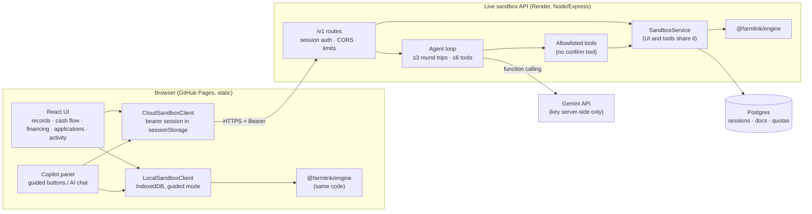

# Architecture

FarmLink AI is a financial agent sandbox for agricultural cooperatives and small agribusinesses. It turns cash records into a dated forecast, matches financing to the projected gap, and prepares a sandbox application that only a human can confirm.

## Components



| Layer | Technology | Responsibility |
| --- | --- | --- |
| Shared engine | TypeScript, BigInt, zod | Money/date types, schemas, cash-flow projection, financing comparison, application state machine, payload hashing, CSV validation, evidence bundle |
| Frontend | React 19, Vite, TypeScript, Tailwind CSS 4, shadcn-style components (Radix), Recharts, lucide | Static site on GitHub Pages; HashRouter; guided mode fully in-browser; opt-in live mode |
| Backend | Node 22, Express 5, zod, helmet, express-rate-limit | `/v1` API, anonymous sessions, ownership, quotas, agent loop, confirmation |
| Storage | Postgres (Neon or Render Postgres); in-memory store for tests | Session-scoped documents, row-locked transactions, atomic quotas |
| Model | Gemini via `@google/genai` behind a `ModelProvider` interface | Proposes tool calls; never executes anything itself |

## Why one shared engine

The spec asked for identical results in local and cloud modes. Instead of writing the engine twice (TypeScript and Python) and testing parity, the browser and the API import the **same** `packages/engine` source. A backend test (`cross-mode parity`) checks that API outputs are byte-identical (canonical JSON) to the engine for the same inputs.

## Data model (summary)

- `MoneyMinor`: a decimal-digit string of paisa. It is a `bigint` inside the engine and is bounded to ±10^14 paisa so chart coordinates stay exact.
- `CivilDate`: a validated `YYYY-MM-DD` string. Arithmetic uses day numbers and is never converted to an instant.
- `Workspace`, `CashEvent`, `FinancingProduct`: zod schemas in `packages/engine/src/schemas.ts`. Unknown product terms are `null`, never `0`.
- `ApplicationDraft → PendingAction → ApprovalDecision → SandboxReceipt`, with `ToolEvent` and `AgentRun` as audit records.
- In Postgres every session-owned record is a row in `docs(session_id, kind, id, seq, data jsonb)`. Rows cascade-delete with the session.

## Core algorithms

**Cash flow** (`cashflow.ts`):

```
window = [asOfDate, asOfDate + forecastDays − 1]
opening(day0) = openingCash
closing(d) = opening(d) + inflows(d) − outflows(d)
funding_gap = max(0, −min closing)
```

- Cancelled events are excluded.
- Settled events before the window are already in the opening cash.
- Planned events before the window are listed as overdue and excluded.
- Events after the window are counted only.
- Alerts are `low` (below the buffer) and `critical` (negative).

**Financing** (`financing.ts`):

```
fee(P) = fixed_fee + round_half_up(P × fee_bps / 10 000)
interest(P) = round_half_up(P × rate_bps × days / (10 000 × 365))
net(P) = P − fee(P)
```

1. Binary-search the minimum principal P in [min, max] with net(P) ≥ gap. This is exact because net is monotonic.
2. Reject the product if funds arrive after the first negative date.
3. Re-project cash with the net disbursement and the maturity repayment added.
4. Report `INCOMPLETE_HORIZON` if maturity falls beyond the window.
5. Classify the result as `fits`, `does_not_fit` or `needs_information`, with reason codes.

Ranking among fits uses lowest total modeled cost, then lowest repayment, then ID.

## Agent run (live mode)

```mermaid
sequenceDiagram
  participant U as User (browser)
  participant API as API /v1/agent/runs
  participant M as Gemini
  participant S as SandboxService
  U->>API: message (Bearer session)
  API->>API: kill switch, per-session run quota
  loop ≤ 3 round trips
    API->>API: reserve global provider-call quota
    API->>M: system prompt + message + tool schemas (+ prior tool results)
    M-->>API: text and/or proposed function calls
    API->>API: allowlist + zod-validate each call (≤ 6)
    API->>S: execute with session-scoped authorization
    S-->>API: real result or error (never faked)
    Note over API: prepare_sandbox_submission → stop immediately
  end
  API-->>U: reply + run timeline + pendingAction?
  U->>API: POST /v1/actions/{id}/confirm + Idempotency-Key (human button only)
  API->>S: re-verify ownership, expiry, versions, payload hash; atomic commit
  S-->>U: server sandbox receipt
```

## Trust boundaries

1. **Browser and API.** The API is public, but every route except health and session creation needs a bearer capability. The workspace is derived from the session, never from client fields.
2. **API and model.** Model output is untrusted. Tool names are checked against an allowlist, arguments are validated with zod, and results come from code. There is no model-callable confirm, approve, transfer or fetch tool.
3. **Records and model.** Record text is passed as `untrusted_description` data. A prompt can't grant permissions.
4. **API and database.** Only the backend reaches Postgres, using a connection string held in the host's secret store.

## Repository layout

```
packages/engine/   shared deterministic engine + tests
frontend/          GitHub Pages app (+ Playwright e2e)
backend/           Express API, agent, storage (+ API safety tests, opt-in Postgres tests)
docs/              architecture, deployment, security, tests, provenance, limits, demo script
.github/workflows/ CI and Pages deployment
render.yaml        Render blueprint for the API
```
